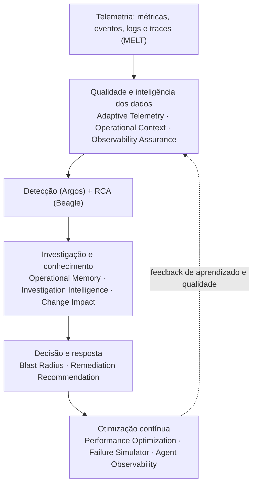

# Backlog de Ciência de Dados para Observability Intelligence

**Revisão:** 13 de novembro de 2026  
**Escopo:** iniciativas de ciência de dados para observabilidade de TI além de detecção de anomalias e RCA tradicional.  
**Contexto:** Argos (detecção), Beagle (RCA) e Companion (investigação assistida); telemetria baseada em traces, com evolução prevista para métricas, eventos, logs e contexto operacional.

## 1. Backlog priorizado

| Prioridade | Projeto | Problema que resolve | Utilidade no pipeline de inteligência de observabilidade | Técnicas de ciência de dados |
|---|---|---|---|---|
| **P0** | **1. Operational Context Intelligence** | Telemetria fragmentada: é difícil relacionar serviços, instâncias, infraestrutura, responsáveis e mudanças. | Enriquece traces e outros sinais com contexto operacional; fornece uma base comum para RCA, análise de impacto e agentes. | Entity resolution, knowledge graphs, graph embeddings. |
| **P0** | **2. Adaptive Telemetry** | Grande volume e custo de armazenamento; o sampling pode descartar traces importantes. | Decide quais dados preservar para manter informação relevante ao RCA e a outras análises, com menor custo. | Otimização combinatória, clustering, sampling adaptativo. |
| **P1** | **3. Operational Memory** | Incidentes semelhantes são investigados repetidamente, sem reaproveitar conhecimento anterior. | Recupera causas, evidências e soluções históricas para acelerar investigações futuras. | Embeddings, RAG, similarity search, case-based reasoning. |
| **P1** | **4. Investigation Intelligence** | Investigações exigem muitas consultas manuais e nem sempre seguem uma sequência eficiente. | Decide quais evidências ou ferramentas consultar em seguida, reduzindo o esforço investigativo do Companion. | Agentes, learning to rank, value of information. |
| **P1** | **5. Performance Optimization Advisor** | Serviços podem funcionar sem incidentes, mas apresentar ineficiências de latência ou consumo de recursos. | Transforma traces em recomendações de otimização, inclusive na ausência de falhas. | Pattern mining, critical path analysis, ranking. |
| **P1** | **6. Blast Radius / Business Impact** | Não está claro quais serviços, jornadas ou clientes são afetados pela degradação de um componente. | Traduz problemas técnicos em impacto operacional e de negócio para apoiar a priorização da resposta. | Grafos, propagação probabilística, Monte Carlo. |
| **P1** | **7. Observability Assurance** | Lacunas de instrumentação e dados incompletos impedem investigações conclusivas. | Avalia se a telemetria disponível é suficiente para diagnosticar falhas e recomenda melhorias de instrumentação. | Data quality, graph coverage, otimização. |
| **P2** | **8. Change Impact Evaluation** | É difícil determinar se um deploy ou mudança realmente provocou degradação. | Estima o efeito de mudanças na saúde e no desempenho dos sistemas, distinguindo coincidência temporal de efeito causal. | Difference-in-Differences, controle sintético, BSTS. |
| **P2** | **9. Remediation Recommendation** | Após identificar a causa, engenheiros ainda precisam decidir qual ação corretiva adotar. | Recomenda e ordena ações por probabilidade de sucesso, risco e reversibilidade, com aprovação humana. | Learning to rank, decisão sob incerteza. |
| **P3** | **10. Failure Propagation Simulator** | Não sabemos antecipadamente como a falha de um componente pode se propagar. | Simula cenários de falha para orientar resiliência, arquitetura e planejamento preventivo. | Monte Carlo, grafos probabilísticos, GNN. |
| **P3** | **11. Agent Observability Intelligence** | Agentes de IA podem apresentar falhas, baixa qualidade e alto custo difíceis de explicar. | Avalia trajetórias, uso de ferramentas, qualidade e eficiência dos agentes operacionais. | Clustering, sequence modeling, LLM evaluation. |

**Legenda:** P0 = capacidade estrutural ou valor imediato; P1 = próximo ciclo de experimentação; P2 = depende de maturidade ou dados adicionais; P3 = pesquisa estratégica. Priorização proposta para o cenário da squad, não um consenso ou benchmark industrial.

## 2. Arquitetura lógica da inteligência de observabilidade

> **Nota de arquitetura:** o diagrama é uma **representação lógica de capacidades**, não uma cadeia obrigatória de execução. Diversas soluções são transversais: Performance Optimization pode funcionar continuamente com traces, Change Impact pode avaliar deploys sem incidente detectado, Blast Radius pode operar em simulações, e Adaptive Telemetry atua antes do armazenamento/consumo dos sinais.

### Papel de cada camada

1. **Telemetria:** disponibiliza sinais técnicos e eventos operacionais, com identificação e tempos consistentes.
2. **Qualidade e inteligência dos dados:** preserva informação relevante, corrige lacunas e contextualiza entidades.
3. **Detecção e RCA:** identifica anomalias e propõe causas candidatas com evidências.
4. **Investigação e conhecimento:** reutiliza históricos, escolhe próximas consultas e avalia o efeito de mudanças.
5. **Decisão e resposta:** traduz achados em impacto e ações potencialmente úteis, com controle de risco.
6. **Otimização contínua:** identifica oportunidades de desempenho, resiliência e melhoria dos próprios agentes.

## 3. Visão para a gestão: como os projetos geram valor

| Tipo de valor | Projetos principais | Benefício esperado |
|---|---|---|
| **Melhorar o diagnóstico** | Operational Context, Operational Memory, Investigation Intelligence, Observability Assurance | Menos esforço investigativo, maior cobertura e diagnósticos mais confiáveis. |
| **Reduzir custo e desperdício** | Adaptive Telemetry, Performance Optimization Advisor | Menos armazenamento e processamento desnecessários; sistemas mais eficientes. |
| **Melhorar decisões operacionais** | Blast Radius / Business Impact, Change Impact Evaluation, Remediation Recommendation, Failure Propagation Simulator | Priorização mais adequada, mudanças mais seguras e resposta mais eficaz. |

**Agent Observability Intelligence** é uma capacidade transversal: pode contribuir para qualidade, custo e confiabilidade das investigações executadas por agentes.

## 4. Indicadores para demonstrar valor

| Projeto | Métrica técnica | Métrica de resultado operacional |
|---|---|---|
| Adaptive Telemetry | Preservação de traces relevantes e Top-k de RCA com orçamento fixo | Custo de telemetria por volume processado |
| Operational Context | Precisão/cobertura das associações de entidades | Tempo para reunir contexto de um incidente |
| Operational Memory | Precision@5 de incidentes relacionados | Tempo de busca por conhecimento anterior |
| Investigation Intelligence | Utilidade das evidências selecionadas; precisão das afirmações | Consultas e tempo de investigação |
| Performance Optimization | Precisão das recomendações | Latência ou consumo efetivamente reduzido |
| Blast Radius | Recall e calibração do impacto previsto | Qualidade da priorização de serviços e jornadas |
| Observability Assurance | Cobertura diagnóstica medida em falhas controladas | Redução de incidentes inconclusivos por falta de dados |
| Change Impact | Erro e robustez da estimativa de efeito | Decisões de release/rollback mais fundamentadas |
| Remediation Recommendation | Precisão da recomendação e avaliação de risco | Taxa de ações eficazes e seguras |
| Failure Propagation Simulator | Fidelidade e calibração da propagação simulada | Melhoria de planos e testes de resiliência |
| Agent Observability | Qualidade das trajetórias e dos resultados de tarefas | Menor custo por investigação bem-sucedida |

> Métricas operacionais exigem verificação apropriada. Melhorias medidas apenas no período pós-implantação podem refletir fatores externos; quando possível, utilizar avaliação controlada ou quase-experimental.

## 5. Orientações de priorização

- **Operational Context Intelligence**: maior potencial de integração transversal com Beagle e Companion, mas depende de alinhar identificadores e informações externas de catálogo/CMDB.
- **Adaptive Telemetry**: bom problema científico e econômico; requer coleta de referência antes do descarte para comparar estratégias de amostragem.
- **Performance Optimization Advisor**: alternativa para gerar valor diretamente com traces, sem depender de detecção nem de incidente.
- **Operational Memory**: exige histórico utilizável de incidentes, soluções e postmortems.
- **Blast Radius / Business Impact**: exige mapeamento confiável entre serviços e jornadas; não inferir impacto monetário apenas de traces amostrados.
- **Remediation Recommendation**: iniciar por recomendações com aprovação humana, não por automação irrestrita.

**Proposta de posicionamento da squad:** evoluir de uma equipe que desenvolve algoritmos para encontrar causas raiz para uma equipe que desenvolve modelos capazes de melhorar decisões operacionais a partir da observabilidade.
